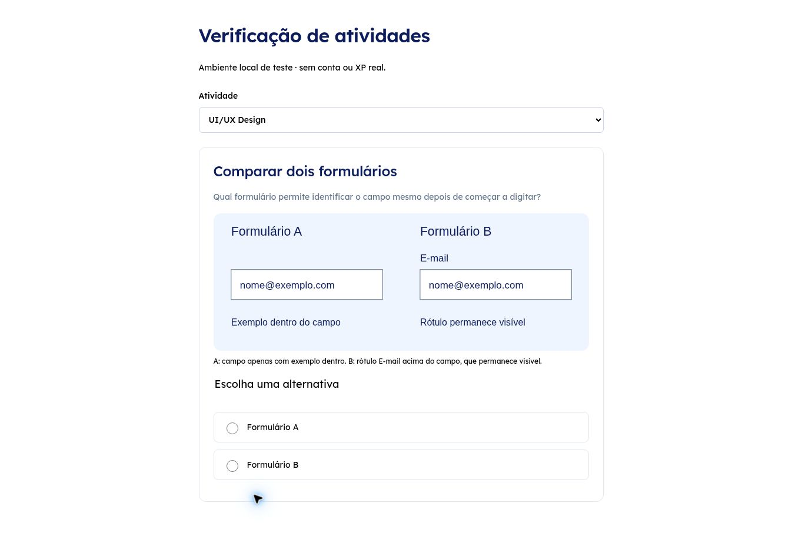

# Atividades por trilha — 25/10/2026

## O que mudou

A seleção do exercício usa `questions.activity_type`, definido pelo conteúdo pedagógico. O nome da trilha não determina o componente. `ActivityRenderer` mantém os formatos anteriores e carrega `CodePractice` por importação dinâmica apenas para `code_practice`. Não há seção independente de Laboratório.

Foram acrescentados 19 exercícios e 19 etapas, incluindo duas trilhas novas. O catálogo passa a ter 130 exercícios, 13 trilhas e 56 etapas. Conteúdo anterior e progresso existente são preservados; o seed usa identificadores estáveis e não duplica registros.

| Área | Atividades acrescentadas |
| --- | --- |
| Python | Múltipla escolha, completar repetição e editor com testes de entrada/saída |
| JavaScript | Ordenar etapas, identificar erro e editor com testes de entrada/saída |
| Desenvolvimento Web | HTML/CSS/JS com prévia isolada e avaliação da estrutura HTML |
| UI/UX | Comparação ilustrada de formulários e ordenação de pesquisa |
| Redes | Topologia ilustrada e diagnóstico de DNS |
| Logística | Cálculo de estoque e ordenação da expedição |
| Português | Concordância e decisão de comunicação em contexto |
| Biologia | Identificação de célula e associação de conceitos |
| Física | Cálculo de velocidade e interpretação de unidades |

Os nove tipos aceitos são `multiple_choice`, `true_false`, `fill_blank`, `matching`, `ordering`, `image_identification`, `calculation`, `case_study` e `code_practice`. `kind` continua existindo para compatibilidade com os seis formatos anteriores; novos registros devem usar uma combinação coerente, validada pelo banco.

Todas as tentativas usam o histórico existente. Acertos, XP, ofensivas e conclusão de módulos passam pelas regras existentes, incluindo pré-requisitos e deduplicação. Cálculos aceitam vírgula ou ponto decimal e usam tolerância explícita. O feedback permite rever e tentar novamente; repetir um acerto não repete o prêmio daquela atividade. A conclusão da etapa mantém seu prêmio próprio, já existente.

## Ativar no Supabase já configurado

Se as migrations 001–007 já foram aplicadas:

1. Abra **SQL Editor → New query**.
2. Copie e execute o arquivo **inteiro** `supabase/migrations/202610220008_activity_types.sql`, de `begin;` até `commit;`. Não execute somente trechos de funções.
3. Em outra consulta, execute o **inteiro** `supabase/seed.sql` atualizado desta branch.
4. Recarregue o aplicativo. Exercícios sem código já usam a correção SQL existente e a nova correção numérica.

Não reaplique migrations antigas nem recrie tabelas. Projetos novos precisam aplicar 001–008 em ordem antes do seed. Esta entrega prepara os arquivos; não executou a migration 008 no projeto hospedado.

## Correção de código em contas reais

**Executar código** testa o programa no navegador; não concede XP. **Validar atividade** chama a Edge Function `grading-code`. Sem a função publicada/configurada, o aplicativo informa a indisponibilidade e não conclui a etapa como se tivesse sido validada.

A função verifica o usuário pelo Supabase Auth, checa a sessão no banco, aplica intervalo mínimo entre solicitações, lê critérios privados e registra o resultado por RPC reservado ao backend. Não aceita um resultado de acerto enviado pelo cliente. A configuração `verify_jwt = false` em `supabase/config.toml` transfere a verificação do gateway para `Auth.getUser` dentro da função; não torna a correção anônima. O registro final verifica novamente a sessão e o perfil estudante.

Para publicar, use a Supabase CLI em um ambiente de desenvolvimento com terminal (por exemplo, Codespaces):

```bash
supabase login
supabase link --project-ref SEU_PROJECT_REF
supabase secrets set --env-file supabase-functions.env
supabase functions deploy grading-code
```

Crie `supabase-functions.env` **fora do repositório**, com os valores reais:

```dotenv
ALLOWED_ORIGINS=https://SEU-DOMINIO.vercel.app
JUDGE0_URL=https://SEU-SERVIDOR-JUDGE0
JUDGE0_PYTHON_ID=ID_PYTHON_DO_SEU_SERVIDOR
JUDGE0_JAVASCRIPT_ID=ID_JAVASCRIPT_DO_SEU_SERVIDOR
```

`ALLOWED_ORIGINS` aceita domínios completos separados por vírgula, sem barra final. Inclua o domínio estável do preview usado. Os IDs de linguagem devem corresponder às versões disponíveis no executor configurado; não copie IDs de outro serviço sem conferir. Conforme o provedor, acrescente `JUDGE0_AUTH_TOKEN` ou o par `JUDGE0_RAPIDAPI_KEY`/`JUDGE0_RAPIDAPI_HOST`. Segredos de Supabase necessários à função são fornecidos pelo ambiente hospedado; nunca use `VITE_` para eles.

Não há executor público escolhido automaticamente, contratação ou cobrança ativada nesta entrega. Python e JavaScript nas contas reais dependem de um Judge0 autorizado e configurado pelo responsável. A avaliação HTML usa parser no servidor e não precisa de Judge0, mas exige a Edge Function publicada. O executor recebe apenas código e casos de teste, sem e-mail ou token da conta. Revise retenção e custos do provedor escolhido antes de habilitar para alunos.

## Execução e limites

- Python: Pyodide 0.27.7 carregado por CDN somente ao executar. Precisa de conexão para carregar o interpretador; não há promessa de runtime Python offline.
- JavaScript: worker isolado com `input()` e `console.log()`, sem APIs de página.
- HTML/CSS/JS: documento único com `style` e `script`; prévia em iframe `sandbox="allow-scripts"`, sem acesso à origem do aplicativo. Recursos de rede externos não são permitidos na prévia. A correção atual avalia estrutura HTML, não aparência ou comportamento arbitrário de JS.
- Python/JS: limite local de cinco segundos após o interpretador carregar, opção de interromper, limite de saída e remoção do worker/frame ao encerrar. A prévia HTML não fornece o mesmo limite de CPU do worker; código web com laço infinito ainda pode comprometer a responsividade da aba.
- CSP permissiva para execução fica restrita a `/code-sandbox/`; a aplicação principal mantém sua política de scripts. Não adicionar `allow-same-origin` a esses frames.
- Service Worker não pré-carrega editor, runtime ou páginas de execução. Os materiais offline existentes continuam separados.
- Demonstração: correção local, explicitamente demonstrativa, sem pontos em contas reais.

## Validação e limites da entrega

- 119 testes Vitest aprovados; 41 verificações PostgreSQL/RLS aprovadas. Relatórios em `docs/ui-test-results.json` e `docs/rls-results.json`.
- Testes incluem escolha por tipo, ausência de editor nas áreas não relacionadas, imagens com descrição, cálculo com erro/revisão/acerto/conclusão, carregamento do editor, falha do executor, resultado incorreto, cancelamento local, sessão inválida, tentativa de forjar acerto e XP duplicado.
- Navegador: fluxo Python completo (questão, completar código, execução retornando 7, validação e conclusão), ordenação e diagnóstico de JavaScript. Execução JavaScript e prévia HTML/CSS/JS verificadas também na página local de QA `tests/browser-activities.html`, que não entra no build de produção.
- TypeScript e build Vite aprovados. Editor e executor geram chunks separados. Permanece o aviso de tamanho do bundle principal, sem falha de build.
- Não houve aplicação da migration no Supabase hospedado, publicação da Edge Function ou teste real de Judge0. Não houve homologação de todos os dispositivos nem comparação pixel a pixel com Figma nesta atualização.

## Decisões de implementação e referências

As atividades e diagramas novos são conteúdo de implementação solicitado neste prompt, não telas extraídas do Figma. Foram preservados os componentes, cores, fontes, navegação e caminho de etapas existentes. O editor é um campo de código acessível com console/prévia; não inclui IDE completa, instalação de pacotes ou avaliação automática de designs livres.

Documentação técnica: [Pyodide](https://pyodide.org/en/0.27.7/usage/quickstart.html), [Judge0](https://ce.judge0.com/), [Supabase Edge Functions](https://supabase.com/docs/guides/functions), [iframe sandbox](https://developer.mozilla.org/en-US/docs/Web/HTML/Reference/Elements/iframe#sandbox).


